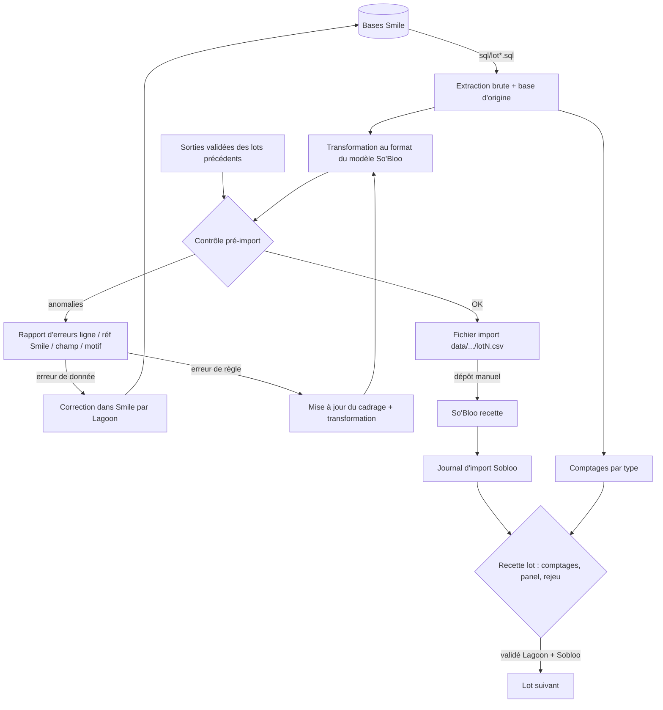
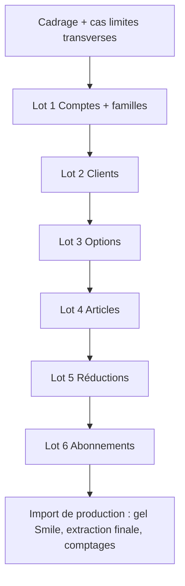

# feat: Plan d'actions Lagoon — reprise Smile vers So'Bloo

## Résumé

Le plan couvre la part Lagoon de la reprise. Il a deux volets menés ensemble, lot par lot :
- les **actions métier** : compléter le cadrage, trancher les cas limites, lever les points ouverts, faire la recette ;
- l'**outillage** de ce dépôt : extraction SQL depuis Smile, mise au format des modèles So'Bloo, contrôle pré-import, rapport d'erreurs et comptages de recette.

Un lot n'avance que lorsque le précédent est validé par Lagoon et par Sobloo.

---

## Contexte

Au 27/10/2026 :
- les colonnes jaunes du fichier de cadrage, celles de Lagoon, sont vides dans les 9 onglets d'import ;
- 24 des 27 cas limites sont « À traiter » et 3 sont « En discussion » (n° 15, 20 et 22) ;
- le dépôt ne contient que la documentation.

Lagoon est la seule à avoir accès à Smile, en **lecture SQL directe**. Elle porte l'exactitude et la complétude des données. Sobloo porte les modèles d'import, le journal et les développements manquants : import des comptes comptables, rejeu des articles et import des abonnements, qui n'existent pas encore.

Le précédent de l'import SEPA montre deux risques à couvrir dès le départ :
- des clients pros répartis sur deux bases ;
- des références en doublon qui ont cassé l'import.

Références : `CLAUDE.md` ; `docs/Imports Lagoon — Compte rendu et plan d_action.docx` ; `docs/Imports_Lagoon_Fichier_de_cadrage.xlsx`. Le cadrage fait foi pour les champs et les règles.

---

## Avancement au 27/10/2026

Cartographie de Smile faite depuis pgAdmin (structure et comptages uniquement) : `docs/cartographie-smile.md`. Premier rapprochement de l'onglet 2 : `docs/correspondance/2-clients.md`. Requêtes dans `sql/`.

**Ce qui est établi**
- **Smile = Inomial Smile sur PostgreSQL**, base `lagoon.nc` (serveur SMILE01 - PROD). Les anciens serveurs DB1 et DB2 sont injoignables : il s'agit probablement d'instances arrêtées. **Une seule base à extraire**, à confirmer par l'admin (cas 1).
- **Accès direct opérationnel** depuis le poste Lagoon (27/10/2026), par `psql` sur une **réplique** (`pg_is_in_recovery() = t`), en lecture seule et avec coupure à 5 minutes. Les résultats agrégés sont écrits dans `data/cartographie/`.
- **Source d'extraction** : les vues de reporting `smile03`, sauf pour le plan en cours d'un abonnement, lu dans `public.planscheduleitem` (type 1 « Accounting plan schedule »). Le filtre de date de la vue coûte trop cher sur la PROD.
- **Volumes** (`sql/perimetre.sql`) :
  - **26 264 clients à reprendre** sur 57 600 comptes Smile : ce sont les clients ayant au moins un abonnement à reprendre. `usn` est unique et toujours renseigné.
  - **50 371 abonnements à reprendre** : Active ou Suspended, hors Self Care et hors plan `inactive`.
  - Environ 68 articles commerciaux réellement utilisés sur 252 plans. Sur 736 options, 144 sont utilisées : 20 réductions (lot 5) et 124 autres, qui mélangent vraies options, choix de frais de mise en service et choix par défaut. Le tri est à faire par Lagoon.

**Décisions Lagoon du 27/10/2026**
- **RIB et mandats SEPA hors périmètre** : ils sont déjà gérés dans So'Bloo. L'import clients ne doit pas les écraser.
- **Self Care (CAT)** : accès au portail client, ces abonnements ne sont pas repris. Leurs indicateurs (accès limité, revendeur) passent sur le client.
- **Plans `active`, `locked`, `closed`, `inactive`, `freesusp`** : ce sont des états techniques. Ils ne sont pas repris comme articles et servent à déduire l'état de l'abonnement.
- **Organisation So'Bloo : Lagoon seule** (pas de Lagoon Business).
- **Procuration** (champ `Procuration_`) : à migrer comme contact avec procuration, **pour les seuls clients repris**, soit 14 437 contacts (`sql/clients_a_reprendre.sql`).
- **Contentieux = statut de recouvrement** : la disposition du compte Smile fait foi (949 comptes, dont 92 ayant 435 abonnements à reprendre), pas le type de compte « Contentieux ». Les comptes en contentieux ayant un abonnement actif sont repris, mais signalés : un compte en contentieux ne devrait pas en avoir (`sql/contentieux.sql`). La date de contentieux à reprendre reste à trancher.

**Conséquences sur le plan**
- **Clés de rapprochement Smile ↔ So'Bloo (décision Lagoon du 27/10/2026)** : `usn` du compte pour les clients (`customer.ref`), `usn` de l'abonnement pour les abonnements. Les contrats d'abonnement Smile ne sont pas utilisés (0 en cours).
- **Les réductions sont des « charging options »** (précision Lagoon du 27/10/2026), et non la table `discount`, qui n'est pas utilisée. Une réduction est une **option de plan** (groupe « charge »), par exemple `alce` « -5% Réduction AMCOM ». Elle porte un frais à **tarif négatif** (article 003141, −212 XPF). L'abonnement la souscrit comme une option (`planscheduleoption`). Mesure (`sql/charging_options.sql`) : **122 options de réduction** au catalogue, dont 93 expirées. **7 217 abonnements à reprendre** en ont au moins une, et **5 653 souscriptions portent sur une option expirée** : sont-elles encore facturées ? Le montant réel dépend du plan (tarif de plan), pas seulement de l'article.
- **Premières anomalies à corriger dans Smile** :
  - 50 doublons de N° Conso+ (`loyalty_card` unique) ;
  - 2 e-mails invalides ;
  - 368 téléphones à 12 chiffres ;
  - 2 165 RIDET au mauvais format (sur 2 828) ;
  - 92 comptes en contentieux avec abonnement actif.
  - 68 abonnements actifs sur le plan `inactive`.

---

## Exigences

**Données et règles**
- R1. Chaque règle de transformation renvoie à une ligne du cadrage (onglet + N°) ou à un cas limite.
- R2. Les extracts sont complets : un fichier par import, toutes bases Smile confondues.
- R3. La référence Smile est présente et unique sur chaque ligne. Les doublons de `customer.ref` sont signalés et bloquent le dépôt jusqu'à l'arbitrage de Lagoon (cas 3), sans fusion automatique.
- R4. Une erreur de donnée n'est jamais corrigée dans le fichier. Elle est signalée, corrigée dans Smile, puis l'extraction est relancée.

**Contrôles**
- R5. Un contrôle pré-import tourne sur chaque fichier. Il vérifie :
  - les colonnes manquantes et les champs obligatoires, y compris les obligations conditionnelles ;
  - les formats : e-mail, téléphone, date, RIDET (le RIB est hors périmètre, déjà géré dans So'Bloo) ;
  - les références inconnues des lots précédents ;
  - les doublons de référence.
- R6. Le rapport d'erreurs donne pour chaque anomalie : numéro de ligne, référence Smile, champ et motif.
- R7. Pas de création partielle : une ligne qui dépend d'un élément rejeté est elle-même signalée, avec le motif de la dépendance.

**Recette et rejeu**
- R8. Les comptages par type, issus de Smile, sont produits à chaque extraction. Ils servent de référence pour vérifier que lignes lues = créées + mises à jour + en erreur.
- R9. Une extraction relancée sur une source inchangée produit un fichier identique. Cela permet de rejouer l'import sans créer de doublon.

**Sécurité**
- R10. Aucune donnée client n'est commitée ni envoyée à un service tiers. Les identifiants Smile restent hors du dépôt.

**Pilotage**
- R11. Chaque cas limite et chaque point ouvert porté par Lagoon reçoit une réponse et une « Règle d'import retenue » avant le démarrage du lot concerné.

---

## Décisions techniques clés

- **Python 3 (3.9 présent sur le poste), bibliothèque standard, aucun pilote de base de données.** Smile est sous PostgreSQL : l'extraction passe par `psql \copy … CSV`, fourni avec pgAdmin (`/Applications/pgAdmin 4.app/Contents/SharedSupport/psql`). `csv`, `re` et `unittest` suffisent. On n'installe pas openpyxl tant que le XLSX n'est pas choisi.
- **Extraction depuis les vues `smile03`**, les vues de reporting d'Inomial : elles sont stables, et lisibles sans connaître le modèle interne. Exception : le plan en cours d'un abonnement est lu dans `public.planscheduleitem`, car le filtre sur `end_time` de la vue coûte environ 18 M par appel.
- **Garde-fous sur la PROD.** Chaque session est en lecture seule (`default_transaction_read_only`), avec un `statement_timeout` exécuté **à part** (dans le même lot que la requête, il ne s'applique pas). Le coût est vérifié avec `EXPLAIN` avant toute nouvelle requête. Les grosses tables de transactions (jusqu'à 469 Go) ne sont jamais lues sans filtre.
- **Une requête SQL versionnée par import, dans `sql/`.** Les requêtes se relisent et se rejouent, et la règle Smile reste visible, ce qui sert R1. Chaque requête porte en commentaire la référence au cadrage.
- **Une seule base, `lagoon.nc`.** La connexion est configurée dans `.env`, non versionné. Si l'admin révélait une autre base active, l'extraction la concaténerait avec une colonne « base d'origine », pour qu'un même client présent sur deux bases ressorte comme doublon (R2, R3).
- **Pipeline en trois temps : extraire, transformer, contrôler.** Le fichier brut, le fichier au format So'Bloo et le rapport d'erreurs sont écrits dans `data/<horodatage>/`, qui est ignoré par git.
- **Le contrôle signale, il ne corrige pas.** Les seules transformations autorisées sont des conversions de règle, documentées dans le cadrage : jours vers mois pour `settlement_period`, codes de famille en minuscules, correspondances de valeurs. Les données métier fausses partent dans le rapport (R4).
- **Le contrôle lit les sorties des lots précédents pour vérifier les références.** Le lot N lit les fichiers validés des lots 1 à N-1 (codes comptes, refs clients, `variant.code`). On peut ainsi détecter une référence inconnue sans accès à So'Bloo (R5, R7).
- **Un module d'écriture unique, en CSV pour l'instant.** Le format n'est pas tranché (porteur Sobloo). Le XLSX se branchera à cet endroit sans toucher aux transformations.
- **Les tests tournent sur des jeux synthétiques et ne voient jamais de données réelles.** Les fixtures sont écrites à la main dans `tests/fixtures/`, avec des cas limites inventés (R10).

---

## Vue d'ensemble



Enchaînement des lots et des portes de validation :



---

## Actions métier Lagoon

Elles ne produisent pas de code mais elles conditionnent les unités techniques : sans règle retenue, une transformation ne peut pas être écrite. Les porteurs suivent le RACI du compte rendu.

| ID | Action | Débloque | Porteur |
|---|---|---|---|
| M1 | Inventaire exhaustif des bases, instances et outils où vivent les données (cas limites 1, 24), volumes attendus (25), encodage et formats (26). **Fait le 27/10** : une seule base, `lagoon.nc`, et inventaire dans `sql/inventaire.sql`. Reste la confirmation de l'admin pour DB1 et DB2 | U2, toutes les extractions | Lagoon |
| M2 | Compléter les colonnes jaunes des onglets 1 et 1b ; trancher les catégories de rapport de vente ↔ comptes 7XXX (cas 21) | U4 | Lagoon |
| M3 | Compléter l'onglet 2 ; trancher les cas 2 à 7, 22, 23 (clients sans réf., doublons d'identifiants, changement de type, clients inactifs, adresses multiples, payeur ≠ titulaire, statuts contentieux, soldes à la bascule) ; décrire « accès limité », mobiles multiples, client Chorus. **En cours** : brouillon dans `docs/correspondance/2-clients.md`. Restent à trancher le type d'adresse de facturation, le RIDET sans établissement, la date de contentieux à reprendre et les 65 « Compte Smile » ayant un abonnement actif | U5 | Lagoon |
| M4 | Compléter les onglets 3 et 4 ; trancher les cas 8 à 12 (options partagées, variantes, ventilation multi-comptes, obsolètes, prix par type/zone) ; lister les frais fixes | U6, U7 | Lagoon |
| M5 | Produire l'inventaire des réductions (cas 13, 14) : sources, nature, période restante | U8 | Lagoon |
| M6 | Compléter les onglets 6, 6a, 6b ; trancher les cas 15 à 19 et 27 (en cours uniquement, suspendus/préavis, période partiellement facturée, propriétés dynamiques, multi-sites/payeurs, évolution des données avant bascule) | U9 | Lagoon |
| M7 | Ateliers de revue du cadrage avec Sobloo : passage des lignes en « Validé » | chaque lot | Lagoon + Sobloo |
| M8 | Choisir le panel de clients représentatifs (particuliers, pros, SEPA, multi-bases, suspendus, contentieux) | U10 | Lagoon |
| M9 | Suivre les dépendances Sobloo : format CSV/XLSX, conservation des fichiers, import comptes, rejeu articles, import abonnements, champs « À créer » | dépôts | Sobloo (suivi Lagoon) |
| M10 | Préparer la fenêtre de production : gel des modifications Smile, ordre d'extraction, validation finale | production | Lagoon |

M1 se traite en premier : il conditionne la complétude de toutes les extractions (R2).

---

## Unités de réalisation

### Phase A — Fondations

### U1. Squelette du dépôt et garde-fous données

**Objectif :** poser la structure. Aucune donnée ni aucun secret ne doit pouvoir être commité.
**Exigences :** R10
**Dépendances :** aucune
**Fichiers :**
- `.gitignore` : `data/`, `*.csv`, `*.xlsx` hors `docs/` et `tests/fixtures/`, `.env`
- `README.md` : usage, variables d'environnement attendues
- `.env.example` : noms des variables, sans valeurs
- `import_lagoon/__init__.py`
- `tests/__init__.py`

**Approche :** paramètres de connexion lus uniquement depuis les variables d'environnement, une entrée par base Smile. Un `.env.example` sans valeurs documente les noms attendus.
**Test expectation :** aucune, échafaudage pur. Vérifier qu'un fichier déposé dans `data/` n'apparaît pas dans `git status`.
**Vérification :** dépôt propre, aucune valeur sensible versionnée.

### U2. Connexion Smile, extraction multi-bases et comptages

**Objectif :** exécuter une requête de `sql/` sur toutes les bases configurées. Écrire le fichier brut avec la colonne « base d'origine » et produire les comptages par type.
**Exigences :** R2, R8, R9
**Dépendances :** U1, M1
**Fichiers :**
- `import_lagoon/extraction.py`
- `import_lagoon/comptages.py`
- `sql/inventaire.sql`
- `tests/test_extraction.py`

**Approche :**
- Tri déterministe sur la référence Smile, pour que deux extractions d'une source inchangée soient identiques (R9).
- Encodage de sortie UTF-8 explicite ; les formats de date et de montant sont normalisés à l'extraction, selon la réponse M1/26.
- Accès par `psql` (PostgreSQL), isolé dans une seule fonction. La session est ouverte en lecture seule, avec `statement_timeout`.

**Scénarios de test :**
- Deux bases simulées contenant chacune 2 lignes : la sortie compte 4 lignes, chacune avec sa base d'origine.
- Même entrée lancée deux fois : sorties identiques octet pour octet.
- Base injoignable : arrêt avec un message qui nomme la base. Aucun fichier partiel n'est laissé.
- Caractères accentués et montants décimaux : préservés à l'aller-retour.
- Comptages : par type de client et par base, et le total égale le nombre de lignes.

**Vérification :** `sql/inventaire.sql` renvoie les volumes par base et par type. Ils servent de référence pour la recette.

### U3. Moteur de contrôle pré-import et rapport d'erreurs

**Objectif :** des contrôles réutilisables par tous les lots et un rapport d'erreurs au format attendu.
**Exigences :** R3, R5, R6, R7
**Dépendances :** U1
**Fichiers :**
- `import_lagoon/controles.py`
- `import_lagoon/ecriture.py`
- `tests/test_controles.py`

**Approche :** chaque contrôle reçoit une ligne et renvoie zéro ou plusieurs anomalies (champ, motif). Les contrôles couvrent :
- les colonnes attendues ;
- les obligatoires simples et conditionnels, par exemple « nom obligatoire si particulier » ;
- l'unicité d'une colonne, avec ou sans casse ;
- les formats : e-mail ; téléphone (6, 8 ou 10 chiffres) ; date ; RIDET (7 chiffres + `.` + 3 chiffres après normalisation) ;
- l'existence d'une référence dans un ensemble issu des lots précédents.

Le rapport reprend le numéro de ligne du fichier généré et la référence Smile.

**Patterns à suivre :** les motifs reprennent le vocabulaire du tableau « Type d'erreur » du compte rendu.

**Scénarios de test :**
- RIDET `123456.001` : normalisé en `0123456.001`. RIDET `12 345` : motif « RIDET au format invalide ».
- Téléphones : 6 chiffres acceptés (+687), 8 acceptés (+689), 10 acceptés (+33), 7 chiffres rejetés.
- E-mail sans « @ » ou avec un domaine vide : rejeté.
- Même référence sur les lignes 3 et 7 : deux anomalies « doublon de référence Smile », chacune avec son numéro de ligne.
- Codes `ABC` et `abc` dans une colonne unique sans casse : doublon détecté.
- Référence absente de l'ensemble du lot précédent : motif « référence introuvable », qui nomme le lot.
- Particulier sans nom : rejeté. Société sans nom : accepté si la raison sociale est présente.
- Fichier sans colonne obligatoire : une seule anomalie de niveau fichier, pas une par ligne.

**Vérification :** le rapport s'ouvre dans un tableur et se trie par champ, ce qui permet de corriger en masse.

### Phase B — Lots

### U4. Lot 1 — Comptes comptables et familles d'articles

**Objectif :** extraire, transformer et contrôler les comptes (généraux et tiers) et les familles d'articles.
**Exigences :** R1, R5
**Dépendances :** U2, U3, M2
**Fichiers :**
- `sql/lot1_comptes.sql`
- `sql/lot1b_familles.sql`
- `import_lagoon/lots/lot1.py`
- `tests/test_lot1.py`
- `tests/fixtures/lot1_*.csv`

**Approche :**
- Comptes (onglet 1) : type général ou tiers (n° 1), code unique par organisation et par table (n° 2), compte général associé existant ou plus haut dans le fichier (n° 7), un seul compte par défaut par type (n° 5).
- Familles (onglet 1b) : code en minuscules et unique (n° 2), parent existant et sans cycle (n° 6), comptes de vente, remise et exonéré présents dans les comptes du lot (n° 9 à 12).
- Les sorties validées servent de référentiel aux lots suivants.

**Scénarios de test :**
- Compte tiers rattaché à un 411 présent plus bas dans le fichier : la sortie est réordonnée ou une anomalie est levée, selon la règle retenue en M2.
- Deux comptes généraux par défaut du même type : anomalie.
- Code famille `ABO-INT` : sortie `abo-int`. Les codes `abo-int` et `ABO-INT` ensemble : doublon.
- Familles A → B → A : cycle détecté.
- Famille dont le compte vente est absent du lot 1 : référence introuvable.

**Vérification :** comptages identiques à Smile et aucune anomalie inattendue sur l'extraction complète.

### U5. Lot 2 — Clients

**Objectif :** produire le fichier clients complet, toutes bases confondues, avec ses doublons signalés.
**Exigences :** R1, R2, R3, R5, R7
**Dépendances :** U4, M3, M8
**Fichiers :**
- `sql/lot2_clients.sql`
- `import_lagoon/lots/lot2.py`
- `tests/test_lot2.py`
- `tests/fixtures/lot2_*.csv`

**Approche :** règles de l'onglet 2.
- `customer.ref` = accountUsn, obligatoire et unique (n° 1). Les doublons inter-bases sont signalés, jamais fusionnés : arbitrage Lagoon (cas 3).
- Obligatoires conditionnels selon le type (n° 2, 4 à 6).
- `siret` et `loyalty_card` uniques (n° 10, 21).
- Normalisation des téléphones (n° 17, 18) et contrôle des e-mails (n° 16).
- Profil de paiement Débit (n° 47) et compte général présent dans le lot 1 (n° 50).
- `settlement_period` converti de jours en mois : règle d'arrondi à faire valider en M3 (n° 55).
- RIB, RUM et mandats (n° 57 à 65, 78) : **hors périmètre**, déjà dans So'Bloo. Les colonnes ne sont pas envoyées, pour ne rien écraser.
- RIDET lu dans `account_contact.abn` et normalisé (n° 9) ; N° Conso+ (`ConsoPlusID`) unique (n° 21).
- Procuration (`Procuration_`) : un contact avec `is_proxy` = Oui (n° 35, 43). Date et lieu de naissance du mandataire absents de Smile : conflit à trancher avec Sobloo (n° 45, 46).
- Accès limité et revendeur lus sur l'abonnement Self Care du client (n° 87, groupe client).
- Adresses : type 0 toujours repris, type 1 seulement s'il diffère (2 787 comptes).
- États bloqué, suspendu et contentieux exprimés en dates, par organisation (n° 23 à 25).
- Parent placé avant ses enfants (n° 27).
- Forme juridique, mention de taxe et compte tiers comparés à une liste blanche issue du cadrage : une valeur inconnue est signalée au lieu d'être créée (n° 8, 49, 51).

**Scénarios de test :**
- Même accountUsn sur deux bases : deux anomalies doublon qui citent chacune sa base d'origine.
- Délai Smile de 30 jours : 1 mois. 45 jours : valeur selon la règle M3, testée explicitement.
- Deux comptes avec le même N° Conso+ : deux anomalies « doublon », aucune ligne envoyée.
- Adresses de type 0 et 1 identiques : une seule adresse. Adresses différentes : deux adresses.
- Valeur de `Procuration_` présente : un contact avec procuration est créé, avec le nom de la personne.
- Forme juridique « SARLL » absente de la liste blanche : anomalie « valeur inconnue ».
- Enfant dont le parent est rejeté : l'enfant est signalé avec un motif de dépendance (R7).
- Client contentieux : `litigation_date` renseignée pour la bonne organisation.

**Vérification :**
- Comptages particuliers et pros égaux à Smile, base par base et au total.
- Panel M8 contrôlé à la main dans le fichier généré.

### U6. Lot 3 — Options d'articles

**Objectif :** extraire les options, y compris les options obsolètes encore utilisées par un abonnement en cours.
**Exigences :** R1, R5
**Dépendances :** U4, M4
**Fichiers :**
- `sql/lot3_options.sql`
- `import_lagoon/lots/lot3.py`
- `tests/test_lot3.py`

**Approche :**
- `variant.code` unique sans casse (n° 1).
- `is_option` = Oui et `is_option_only` toujours renseigné (n° 6, 7).
- Un prix Abonnement impose une fréquence de facturation (n° 11) ; un prix vide est signalé, jamais mis à 0.
- Famille présente dans le lot 1b (n° 5).
- La requête joint les abonnements en cours pour inclure les options obsolètes utilisées (n° 14, cas 11). Volume attendu : 144 options utilisées sur 736.
- Les plans de cycle de vie (`active`, `locked`, `closed`, `inactive`, `freesusp`) sont exclus du catalogue.

**Scénarios de test :**
- Option obsolète utilisée par un abonnement en cours : présente, avec `is_deleted` = Oui.
- Option obsolète inutilisée : exclue.
- Prix Abonnement sans fréquence : anomalie. Prix vide hors prix libre : anomalie.
- `is_option_only` vide en source : valeur par défaut issue de la règle M4, jamais vide en sortie.

**Vérification :** nombre d'options égal à Smile, obsolètes utilisées comprises.

### U7. Lot 4 — Articles standards

**Objectif :** extraire les articles, leurs liens vers les options et les frais fixes.
**Exigences :** R1, R5, R7
**Dépendances :** U6, M4
**Fichiers :**
- `sql/lot4_articles.sql`
- `import_lagoon/lots/lot4.py`
- `tests/test_lot4.py`

**Approche :**
- Mêmes règles de code et de prix que U6.
- Les options liées doivent exister dans la sortie du lot 3.
- Taxes propres signalées quand elles remplacent celles de la famille, pour revue.
- Compte de l'article présent dans le lot 1.
- Frais fixes repérés selon la liste M4.
- La forme du lien article ↔ groupe d'options suit le modèle Sobloo, non encore fourni (voir les questions ouvertes).

**Scénarios de test :**
- Article lié à une option absente du lot 3 : référence introuvable.
- Option rejetée au lot 3 : l'article qui la référence est signalé (R7).
- Article obsolète utilisé par un abonnement en cours : inclus.
- Article avec taxes propres différentes de sa famille : avertissement non bloquant.

**Vérification :** liens articles ↔ options vérifiés sur un échantillon choisi par Lagoon.

### U8. Lot 5 — Réductions

**Objectif :** mettre au format le fichier des réductions fourni par Lagoon (M5), qui n'existe pas dans les données actuelles. Dans Smile, les réductions sont des « charging options » : des options de plan dont le frais a un tarif négatif, souscrites par l'abonnement. Le tarif peut être surchargé par abonnement (`psiplanautocharge`), et il existe aussi des frais négatifs ajoutés directement (`userautocharge`). La table `discount` n'est pas utilisée. Les options expirées, mais encore souscrites, sont à traiter (cas 14). Le fichier du lot 5 sera donc **extrait de Smile**. Il reste à décider s'il porte des réductions So'Bloo ou des prix négociés sur les lignes d'abonnement (`estimate_line.price_value` / `discount_*`, onglet 6 n° 10 à 12).
**Exigences :** R1, R5
**Dépendances :** U7, M5
**Fichiers :**
- `import_lagoon/lots/lot5.py`
- `tests/test_lot5.py`
- `sql/lot5_reductions.sql`, seulement si M5 situe les réductions dans Smile

**Approche :**
- État Validée (et non Brouillon), pas de compte sur la réduction.
- Les articles ciblés doivent exister dans le lot 4.
- La clé de rapprochement reste à définir avec Sobloo : `discount.code` transforme la réduction en code promo.

**Scénarios de test :**
- Réduction dont l'article cible est absent : référence introuvable.
- État source vide : sortie « Validée ».
- Deux réductions sur le même article et le même client : avertissement, car So'Bloo retient le prix le plus bas sans cumul.

**Vérification :** inventaire M5 rapproché ligne à ligne du fichier généré.

### U9. Lot 6 — Abonnements en cours

**Objectif :** produire les abonnements (devis de type Abonnement), leurs lignes et leurs options en lignes enfants, avec des dates qui évitent la double facturation comme le trou à la bascule.
**Exigences :** R1, R3, R5, R7
**Dépendances :** U5, U7, U8, M6
**Fichiers :**
- `sql/lot6_abonnements.sql`
- `sql/lot6a_internet.sql`
- `sql/lot6b_voip.sql`
- `import_lagoon/lots/lot6.py`
- `tests/test_lot6.py`

**Approche :**
- Périmètre « en cours » (cas 15, 16).
- Clé de rapprochement : **`usn` de l'abonnement Smile** (décision Lagoon du 27/10/2026). Il est unique et jamais vide ; les contrats d'abonnement Smile ne sont pas utilisés. Le modèle Sobloo doit porter cette clé (`subscription_contract.ref` ou équivalent, n° 25). `estimate.contract_number` n'est jamais utilisé (n° 1).
- Population : abonnements Active ou Suspended, hors Self Care (CAT), soit environ 50 400. Plan en cours = ligne du plan de facturation de type 1 sans successeur passé.
- État : un plan de cycle de vie `locked` ou `freesusp` donne Suspendu (cas 16, à valider). `inactive` ou `closed` sur un abonnement actif est une anomalie à corriger dans Smile.
- Le client existe dans le lot 2 (n° 2) et chaque article dans le lot 4 (n° 6). Chaque option est rattachée à son article (n° 7).
- `estimate_line.start_date` obligatoire (n° 13).
- La « prochaine échéance » Smile est convertie en dates de début et de facturation, selon la règle tranchée au cas 17 (n° 19).
- État Validé, Suspendu ou Partiellement suspendu. Un contrat « résilié » se traduit par une date de fin passée et n'est pas repris comme état (n° 4).
- Les propriétés 6a et 6b deviennent des propriétés de ligne, rattachées par la référence du contrat (n° 23).

**Exécution :** commencer par les tests de calcul de dates. C'est le point le plus risqué financièrement.

**Scénarios de test :**
- Abonnement mensuel facturé jusqu'au 31/10, prochaine échéance le 01/11 : dates produites telles que So'Bloo facture à partir du 01/11, sans refacturer octobre.
- Abonnement trimestriel à mi-période à la bascule : comportement conforme à la règle du cas 17.
- Ligne sans date de début : rejetée, motif « ligne jamais facturée ».
- Client rejeté au lot 2 : l'abonnement est signalé avec un motif de dépendance (R7).
- Option non rattachée à l'article de la ligne parente : anomalie.
- Contrat Smile suspendu : état Suspendu. Contrat en préavis : état selon la règle du cas 16.
- Propriété 6a qui référence un contrat absent de l'onglet 6 : référence introuvable.

**Vérification :** un échantillon d'abonnements est contrôlé sur le client, les articles, les réductions, l'échéance, le montant et les propriétés.

### Phase C — Recette

### U10. Rapprochement de recette

**Objectif :** comparer, pour chaque lot, les comptages Smile, le fichier déposé et le journal d'import So'Bloo, puis tracer la validation.
**Exigences :** R8, R9
**Dépendances :** U2 et au moins un lot déposé en recette
**Fichiers :**
- `import_lagoon/recette.py`
- `tests/test_recette.py`

**Approche :**
- Lecture du journal So'Bloo (lignes lues, créées, mises à jour, en erreur) dans le format exporté par Sobloo.
- Contrôle de l'égalité lus = créés + mis à jour + erreurs, et de l'écart avec les comptages Smile.
- Sur un rejeu, le nombre de créations attendu est 0.

**Scénarios de test :**
- Journal équilibré et égal aux comptages : statut OK.
- Lus ≠ créés + mis à jour + erreurs : écart signalé.
- Rejeu avec des créations > 0 : alerte « doublons probables ».

**Vérification :** une fiche de recette par lot, jointe à la validation écrite de Lagoon.

---

## Arborescence prévue

```text
.gitignore
.env.example
README.md
sql/            inventaire.sql, lot1_*.sql … lot6b_voip.sql
import_lagoon/  extraction.py, comptages.py, controles.py, ecriture.py, recette.py
  lots/         lot1.py … lot6.py
tests/          test_*.py
  fixtures/     jeux synthétiques uniquement
data/           (ignoré) extractions horodatées, fichiers d'import, rapports
```

---

## Périmètre

**Hors périmètre**
- Les développements côté Sobloo : import des comptes, rejeu des articles, import des abonnements, journal, conservation des fichiers, champs « À créer ». Ils sont suivis en M9.
- L'historique des factures, ainsi que les clients et abonnements résiliés, sauf décision contraire aux cas 5 et 15.
- Le dépôt automatisé dans So'Bloo : le dépôt reste manuel, via le modèle d'import générique.

**Reporté à plus tard**
- La sortie XLSX avec validations, une fois le format tranché par Sobloo.
- Les propriétés dynamiques client (n° 69), qui ne disposent ni d'import ni de contrôle serveur : on attend la solution de Sobloo.

---

## Risques et dépendances

| Risque | Effet | Parade |
|---|---|---|
| Base Smile oubliée (précédent SEPA) | Clients ou abonnements manquants | M1 en premier ; colonne « base d'origine » ; comptages par base |
| Doublons de `customer.ref` (pas d'unicité en base So'Bloo) | Doublons silencieux, imports cassés | Contrôle bloquant U3/U5, arbitrage Lagoon |
| Mauvaise traduction de la prochaine échéance | Double facturation ou période non facturée | Cas 17 tranché avant U9 ; tests de dates en premier |
| Valeurs créées à la volée par l'import (forme juridique, mention de taxe, compte tiers) | Référentiels pollués par des fautes de frappe | Listes blanches dans U5 |
| Modèles d'import Sobloo non livrés ou changeants | Transformations à reprendre | Colonnes centralisées par lot ; écriture isolée |
| Données Smile modifiées entre l'extraction finale et la bascule (cas 27) | Écarts au démarrage | Gel Smile pendant la fenêtre (M10) ; comptages avant et après |
| Fuite de données personnelles ou bancaires | Incident RGPD | `.gitignore` dès U1, fixtures synthétiques, aucun envoi externe |

---

## Questions ouvertes

**À trancher avant de commencer**
- Compte dédié en lecture seule : l'accès direct fonctionne avec le compte nominatif, sur une réplique. Un compte dédié reste demandé à l'admin.
- Confirmation que DB1 et DB2 sont arrêtés et que toutes leurs données sont dans `lagoon.nc` (cas 1).
- Le modèle Sobloo du lot 6 doit porter l'`usn` de l'abonnement comme clé de rapprochement (clé décidée le 27/10/2026) : sur quel champ ?
- Modèle du catalogue (lots 1b, 3 et 4), proposé par Lagoon : **1 service Smile = 1 famille d'articles So'Bloo, 1 plan Smile = 1 article**. Les charging options restent des options rattachées à l'article. À valider avec Sobloo.
- Import clients sans écraser le RIB et le mandat SEPA déjà présents dans So'Bloo : comportement à confirmer par Sobloo.

**Reportées à la réalisation**
- Colonnes exactes des modèles d'import : elles seront fournies par Sobloo, lot par lot.
- Règle d'arrondi jours → mois pour `settlement_period` (M3).
- Forme du lien article ↔ groupe d'options dans le modèle du lot 4.
- Clé de rapprochement des réductions (U8).
- Format d'export du journal d'import So'Bloo (U10).
